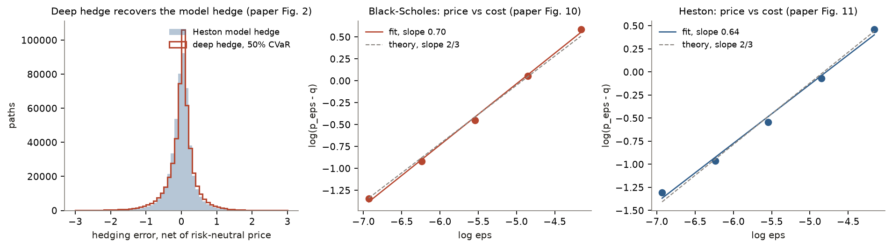
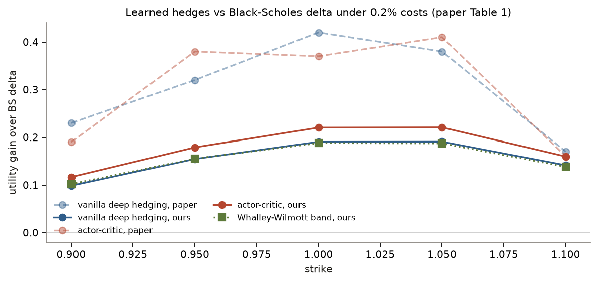

# deep-hedging

A from-scratch reproduction of J.P. Morgan's two Deep Hedging papers, checked
number by number against what they publish.

1. **Buehler, Gonon, Teichmann, Wood, "Deep Hedging"**, Quantitative Finance
   19(8), 2019 ([arXiv:1802.03042](https://arxiv.org/abs/1802.03042)). A neural
   hedging strategy is trained by gradient descent straight through the
   simulated P&L under a convex risk measure (CVaR or entropic), and the
   trained strategy's indifference price is the model's answer to "what should
   I charge for this option given that I can only hedge it imperfectly?"
2. **Murray, Wood, Buehler, Wiese, Pakkanen, "Deep Hedging: Continuous
   Reinforcement Learning for Hedging of General Portfolios across Multiple
   Risk Aversions"**, ICAIF 2022
   ([arXiv:2207.07467](https://arxiv.org/abs/2207.07467)). A risk-averse
   actor-critic where risk aversion is part of the state, so one pair of
   networks hedges every strike at every risk aversion.

Everything is implemented here from the papers' text: the Heston simulator,
Heston pricing, both learning algorithms, the baselines and the scoring. No
code from J.P. Morgan's own repositories is used. Not affiliated with
J.P. Morgan.

Every number below was measured on one M2 Pro laptop and is regenerated from
the saved runs by `scripts/report.py`. The full tables are in
[`bench/`](bench).

## Results: Buehler et al. (2019)

Heston with a spot and a variance swap as hedging instruments, 30 daily
rebalances, ATM call. Each learned number is the mean ± std over 3 seeds, each
trained for 30,000 steps of 256 paths and scored on the same 500,000 held-out
paths.

| claim | paper | here | |
|---|---:|---:|---|
| Risk-neutral ATM price q | 1.69 | 1.6918 | reproduced |
| Deep-hedge price, 50% CVaR, no costs | 1.94 | 1.983 ± 0.002 | within 2.2% |
| Deep-hedge price, 99% CVaR, no costs | 3.49 | 2.857 ± 0.046 | lower, see below |
| Fig. 7: 99%-trained strategy, realized 50% CVaR | 0.527 | 0.558 | close |
| Fig. 7: 50%-trained strategy, realized 99% CVaR | 2.363 | 2.135 | same trade-off |
| Fig. 10: BS price vs cost, log-log slope | 0.67 | 0.698 ± 0.004 | theory: 2/3 |
| Fig. 11: Heston price vs cost, log-log slope | 0.71 | 0.638 ± 0.024 | theory: 2/3 |
| Fig. 5: 1% costs, recurrent vs simpler network | 5.51 vs 6.74 | 4.61 vs 4.64 | gap not reproduced |

The Heston model hedge (risk-neutral delta in the spot plus the model's
variance-swap hedge, no learning) scores a 50% CVaR of 1.946 and a 99% CVaR of
3.418 on the same held-out paths. The 50%-CVaR deep hedge comes close to
that strategy: its P&L distribution nearly coincides with the model hedge's
(left panel above), the comparison the paper makes in its Figure 2.

A trained hedge could look good by exploiting a flaw in the simulator rather
than by hedging, so every run also reports its mean trading gain on held-out
paths. Without costs it should be zero up to Monte Carlo error and the
scheme's small discretization bias. It is between -0.0044 and -0.0052 (standard
error 0.003) for all six zero-cost runs here.

## Results: Murray et al. (2022), Table 1

Short call on notional 100, spot-only hedging, 0.2% proportional costs,
exponential utility at λ = 0.1 (higher is better). One actor-critic serves all
five strikes; vanilla deep hedging trains one model per strike. Mean over 2
seeds, all policies scored on the same 200,000 held-out paths.

| K | BS delta, paper | here | vanilla DH, paper | here | actor-critic, paper | here |
|---|---:|---:|---:|---:|---:|---:|
| 0.90 | -11.10 | -11.035 | -10.87 | -10.936 | -10.91 | -10.918 |
| 0.95 | -7.06 | -7.021 | -6.74 | -6.867 | -6.68 | -6.842 |
| 1.00 | -3.78 | -3.780 (fit) | -3.36 | -3.590 | -3.41 | -3.560 |
| 1.05 | -1.52 | -1.586 | -1.14 | -1.395 | -1.11 | -1.365 |
| 1.10 | -0.43 | -0.491 | -0.26 | -0.349 | -0.27 | -0.331 |

Seed-to-seed std is at most 0.011 for vanilla and 0.004 for the actor-critic.

**What reproduces:** both learned hedges beat the Black-Scholes delta hedge at
every strike, and the single actor-critic matches or beats five separately
trained vanilla networks. Here it beats them at every strike, by 0.018 to 0.030.

**What does not:** the size of the improvement. At K = 0.90 to 1.05 the gain
over BS delta here is about half the paper's (at the money, +0.19 vanilla and
+0.22 actor-critic, against +0.42 and +0.37). At K = 1.10 it matches.

The table also has two columns the paper does not. Whalley-Wilmott is the
classic closed-form no-trade band for proportional costs. The ablation is
vanilla deep hedging without its previous holding as a network input:

| K | BS delta | Whalley-Wilmott band | vanilla DH | vanilla DH, no holding input | actor-critic |
|---|---:|---:|---:|---:|---:|
| 0.90 | -11.035 | -10.933 | -10.936 | -10.950 | -10.918 |
| 0.95 | -7.021 | -6.866 | -6.867 | -6.902 | -6.842 |
| 1.00 | -3.780 | -3.593 | -3.590 | -3.634 | -3.560 |
| 1.05 | -1.586 | -1.399 | -1.395 | -1.422 | -1.365 |
| 1.10 | -0.491 | -0.352 | -0.349 | -0.348 | -0.331 |

A 3 x 256 network trained pathwise for 15,000 steps lands within 0.004 of the
closed-form band at every strike. Only the actor-critic clears the band.

**One network, every risk aversion.** The paper's central claim is that
conditioning on λ lets one actor-critic serve all risk aversions. Scoring the
same trained network at K = 1.00, either told the true λ or frozen at 0.1:

| λ | told the true λ | frozen at λ = 0.1 | gain |
|---:|---:|---:|---:|
| 0.0001 | -3.312 | -3.459 | +0.147 |
| 0.005 | -3.369 | -3.464 | +0.095 |
| 0.1 | -3.560 | -3.560 | 0 |
| 1 | -4.049 | -4.547 | +0.498 |

Telling the network the true λ helps at every λ other than the one it was
frozen at, and most at λ = 1. This part reproduces.

## Three things the papers leave out

Each of these changed a headline number. The first two are pinned by tests.

**1. The paper-literal variance swap is a free lunch on the last day.** The
2019 paper hedges with the variance swap S2 = I + L, where I is the realized
variance so far and L(t, v) is the continuous-time expected future variance.
Simulated on a daily grid, I accrues as a sum of V·h, but L is the continuous
formula. On the final step L drops to 0, so the last increment of S2 is
(V − θ)(h − (1 − e^(−κh))/κ): a number known one day in advance. A network free
to size its variance-swap position finds it, and my first run priced the ATM
call at **−18.76** with a riskless trading profit. Dissecting the P&L by date
put all of it on the last day. The fix is the fair leg of the *discrete* sum
the simulator actually accumulates,

    L_d = h [ M θ + (v − θ)(1 − e^(−κMh)) / (1 − e^(−κh)) ],   M = steps left,

which makes S2 an exact martingale on the grid and tends to the paper's L as
h → 0 (`heston.variance_swap_fair_leg_discrete`,
`tests/test_heston.py::test_discrete_variance_swap_is_a_martingale_every_step`).
The paper-literal leg is kept behind `variance_swap="continuous"` to reproduce
the arbitrage.

**2. The variance swap has to be rescaled about 1000x to be learnable.** The
model hedge holds roughly 390 units of the variance swap per call, because S2
moves about a thousandth as much per day as the spot. A network with default
initialization outputs positions of order one, and training stalled at a 50%
CVaR price of 2.42 against the paper's 1.94. Pricing each instrument in units
that match the spot's daily volatility (c ≈ 1060 for S2) fixed it. The P&L is
exactly invariant under (S·c, δ/c), including costs and liquidation, so no
reported number depends on the choice (`scaling.py`, `tests/test_scaling.py`).

**3. Liquidating the book at maturity is free.** The 2019 paper says in
Section 2 that the book is liquidated at T, and on page 6 that "zero transaction
costs at maturity" are assumed. Charging the liquidation added ε·|δ|·S_T to
every cost-bearing price, bent the Black-Scholes cost asymptotics to a slope
of 0.778 against the theory's 2/3, and inflated the Figure 5 prices. With the
charge removed the slopes are 0.698 (BS) and 0.638 (Heston).

A fourth gap is a missing number rather than a subtle one: the 2022 paper does
not state the initial variance v0. It is fitted here on a single cell of
Table 1 (BS delta at K = 1.00, `scripts/calibrate_v0.py`, v0 = 0.1205), and
the other four BS-delta cells then serve as out-of-sample checks. They land
within 0.07 of the paper.

## What did not reproduce

**The 99% CVaR price (2.86 here, 3.49 in the paper).** The Heston model hedge
reaches a 99% CVaR of 3.42 on the same paths without any learning, and a
policy trained to minimize 99% CVaR should do at least as well as the model
hedge it can approximate. The paper's 3.49 is above that, which suggests their
99% network stopped short in the tail. Finding 2 is one plausible reason, but
that is an inference I could not check against their code. The arbitrage
check rules out the other explanation, that my lower number comes
from exploiting the simulator.

**The recurrent network's advantage under 1% costs (paper Fig. 5).** The paper
prices the ATM call at 5.51 with the semi-recurrent network, which sees its
previous holding, and at 6.74 with the simpler one, which does not. Here the
two are 4.61 ± 0.04 and 4.64 ± 0.10, both below the paper's better number. The
run with the liquidation charge (finding 3) showed the same near-tie, 5.11 vs
5.17. I do not have a verified explanation, and the trained networks were not
kept, so their turnover cannot be inspected after the fact.

**The size of the 2022 improvement over BS delta.** The gains here are about
half the paper's at four of five strikes. Two independent methods, the
Whalley-Wilmott band and a separately trained vanilla network, agree to within
0.004 at every strike. So the smaller gains are unlikely to be one method
failing to train. The likelier source is the market setup: the paper does not
state v0, and it had to be fitted to one table cell. That is an inference, not
something I could check. The first vanilla run here left out the previous
holding. It fell below the band at four strikes, and adding the holding (which
both papers' networks see) brought it level with the band. That run is kept
above as the ablation.

## Deviations and budget

- **Compute.** The 2022 actor-critic ran 15,000 iterations of 2048 episodes
  per seed (about 61 minutes each on MPS, two seeds sharing the GPU), 6.7x
  fewer than the paper's 100,000. From scratch the whole study, 2019 and 2022,
  is about two hours of laptop time.
- **Scoring.** Every policy, including the actor-critic, is scored by Monte
  Carlo on held-out paths through one P&L function, `pnl.hedge_pnl`. Utilities
  are never read off the critic, whose value estimates are unreliable at high
  λ.
- **Simulation.** Heston variance is sampled exactly from the CIR transition
  law, with V held constant within a step for the spot (the simplified
  Broadie-Kaya scheme of the 2019 paper's footnote 5). The 2022 runs use 4
  substeps per trading day. Variance is observable: the 2019 paper feeds V_k
  to the network, and the 2022 paper uses √V as the implied vol.
- **Features.** The 2019 networks see (log S, V) plus, when semi-recurrent,
  the previous holding. The 2022 actor and critic see the book's
  Black-Scholes Greeks at implied vol √V, strike, time, log spot, variance and
  log λ, standardized under the BS-delta policy as the paper describes.
- **Seeds.** 2022 seeds are 0 and 10, not 0 and 1. Iteration i of seed s
  draws its paths with sample seed 7919·s + i + 1, so seeds 0 and 1 would
  train on the same paths after iteration 7,919.

## Layout

    src/dhedge/
      spec.py            paper parameters (both Heston setups), time grid
      heston.py          exact-CIR Heston simulator, both variance-swap legs
      heston_pricing.py  Heston call price and Greeks (Lewis integral), model hedge
      bs.py              Black-Scholes price and Greeks
      markets.py         GBM paths
      pnl.py             the one P&L definition every result goes through
      risk.py            entropic risk, exponential utility, CVaR (exact and OCE)
      scaling.py         exact instrument rescaling (finding 2)
      baselines.py       BS delta, Whalley-Wilmott no-trade band
      deep_hedge.py      2019 per-date networks, shared network, pathwise training
      features.py        2022 Greek features and normalization
      actor_critic.py    2022 risk-averse actor-critic
    scripts/
      reproduce_2019.py  Section 5 of the 2019 paper (42 trainings)
      calibrate_v0.py    fits the 2022 paper's unstated v0 on one table cell
      reproduce_2022.py  Table 1 and the λ sweep
      report.py          tables in bench/ and figures in docs/ from saved runs
    tests/               123 tests, about 2 minutes

## Running

    uv sync
    uv run pytest
    uv run python scripts/reproduce_2019.py        # about 45 min on 6 cores
    uv run python scripts/calibrate_v0.py
    uv run python scripts/reproduce_2022.py        # about 60 min, uses MPS if present
    uv run python scripts/report.py

Runs write to `runs/`, which is gitignored; `bench/` holds the tables they
produced.

## License

MIT
